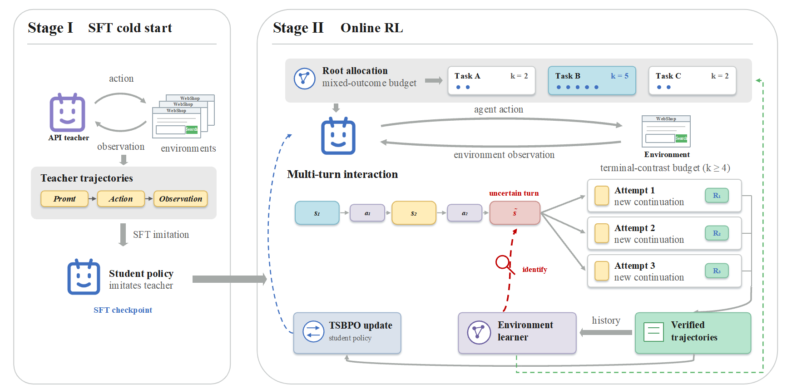
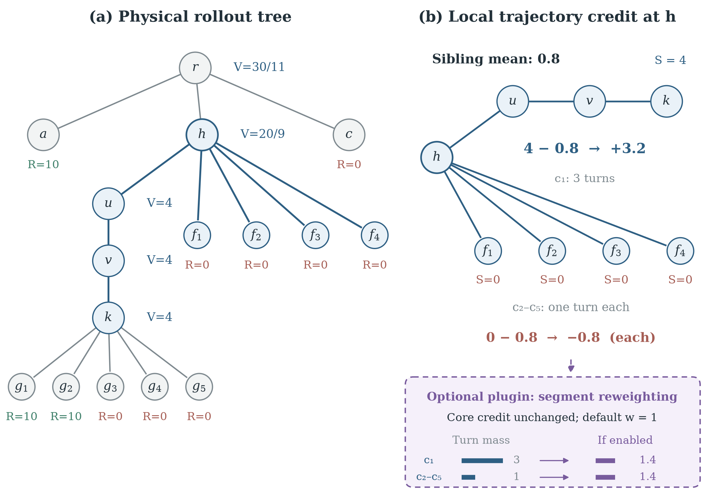
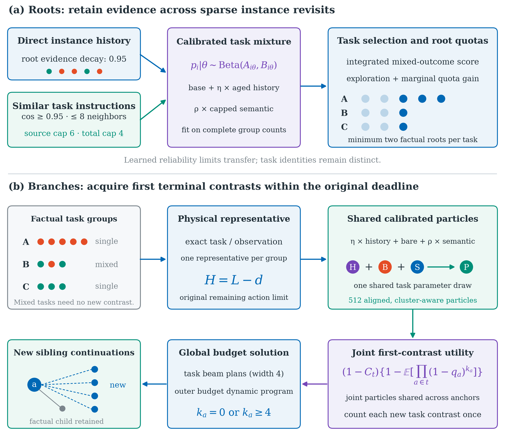

# EL-TSBPO

EL-TSBPO is a two-stage training workflow for language-model agents in ALFWorld and WebShop. Successful teacher trajectories provide an SFT cold start; a task-aware root and branch allocator then collects physical rollout trees for RL. The RL implementation extends `verl-agent` and retains its `verl` package layout.



## Repository layout

| Path | Contents |
| --- | --- |
| [`verl-agent/`](verl-agent/) | RL framework, ALFWorld and WebShop environments, EL-TSBPO algorithm, collectors, tests, and two training scripts |
| [`llamafactory/`](llamafactory/) | SFT configurations and dataset registration; install LlamaFactory separately |
| [`docs/assets/`](docs/assets/) | Figures from the manuscript |

The SFT datasets, checkpoints, ALFWorld game data, and WebShop product data are deliberately excluded. Local outputs are written under `verl-agent/.local/` and ignored by Git.

## Method

The rollout tree records each factual trajectory and the continuations sampled from selected states. Physical tree relationships determine trajectory credit, and state-action groups provide local comparisons. Segment balancing is an optional policy-weighting setting in the RL configuration.



The allocator uses calibrated task and state evidence to distribute factual root and branch samples under separate budgets. Branch selection conditions on the remaining interaction horizon and allocates within a task-level mixed-outcome objective.



## Setup

Use a Python 3.10 environment for `verl-agent`, CUDA-capable PyTorch, and the compatible vLLM build for your CUDA installation:

```bash
cd verl-agent
python -m pip install -e '.[train,alfworld]'
```

ALFWorld requires game assets (`alfworld-download -f`, or set `ALFWORLD_DATA`). For WebShop, install its environment dependencies and prepare the 1,000-product catalog from `verl-agent/agent_system/environments/env_package/webshop/webshop/` with `bash setup.sh -d small`. The setup script downloads product data and builds its search index. Set `JAVA_HOME` to the JDK in the WebShop environment before running the collector or trainer. Keep a separate Python 3.11 environment for LlamaFactory; its upstream package is not included in this repository.

## Stage 1: SFT cold start

The collectors run against an OpenAI-compatible teacher API and write only successful training trajectories. They default to `gpt-5.6-sol`; set `OPENAI_API_KEY`, `OPENAI_BASE_URL` if needed, and `OPENAI_MODEL` to override the teacher in the RL environment. Run from the repository root:

```bash
python verl-agent/examples/prompt_agent/openai_alfworld_collector.py
python verl-agent/examples/prompt_agent/openai_webshop_collector.py
```

The default output files are `llamafactory/data/data.json` and `llamafactory/data/webshop_success_data.json`. Collection makes paid API requests and is never triggered by the training scripts. See [`llamafactory/README.md`](llamafactory/README.md) for the dataset format, separate SFT environment, and training commands.

## Stage 2: RL training

After SFT, the configurations place the checkpoints at `verl-agent/.local/models/alfworld-sft` and `verl-agent/.local/models/webshop-sft`. Download a compatible embedding model and set `EL_TSBPO_EMBEDDING_MODEL` to its local directory. Then run either benchmark from `verl-agent/`:

```bash
cd verl-agent
export EL_TSBPO_EMBEDDING_MODEL=/path/to/Qwen3-Embedding-0.6B
CUDA_VISIBLE_DEVICES=0,1,2,3 bash examples/el_tsbpo_trainer/run_alfworld.sh
CUDA_VISIBLE_DEVICES=0,1 bash examples/el_tsbpo_trainer/run_webshop.sh
```

The WebShop script requires an even number of GPUs. Set `EL_TSBPO_MODEL` to override a checkpoint and `EL_TSBPO_WORK_DIR` to relocate local training outputs. The common RL defaults live in [`el_tsbpo.yaml`](verl-agent/verl/trainer/config/el_tsbpo.yaml); the scripts contain only benchmark-specific overrides. They call the trainer directly, without a `screen` session.

## Verification

In the RL environment, run the focused CPU checks:

```bash
cd verl-agent
python -m pytest -q tests/trainer/ppo
```

Full training requires GPU, environment assets, and model checkpoints. The repository contains no pretrained weights or collected demonstrations.

## Licenses

This repository is distributed under [Apache License 2.0](LICENSE). It includes code derived from `verl` and `verl-agent`; nested WebShop and ALFWorld environment components retain their MIT license notices. LlamaFactory is a separately installed upstream dependency. See [NOTICE](NOTICE) for attribution.
